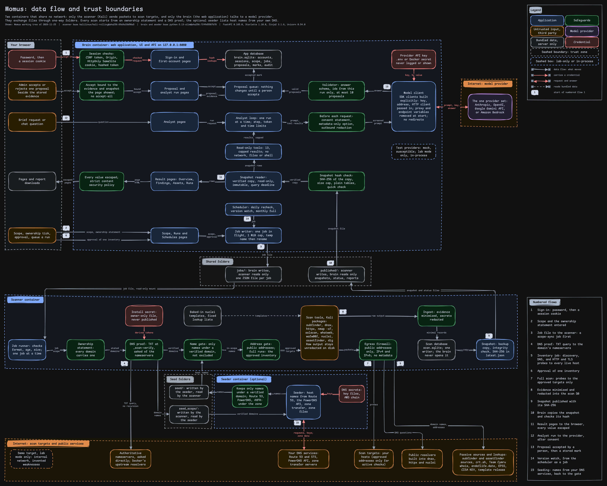
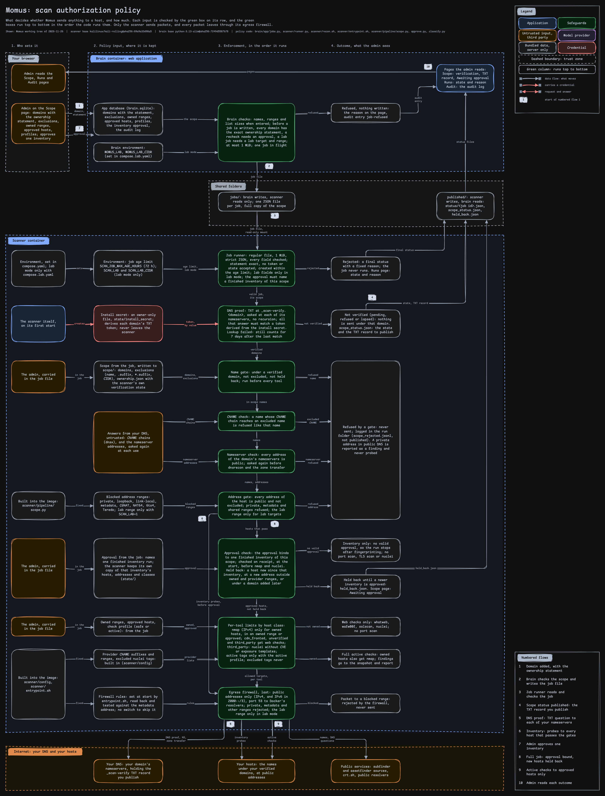
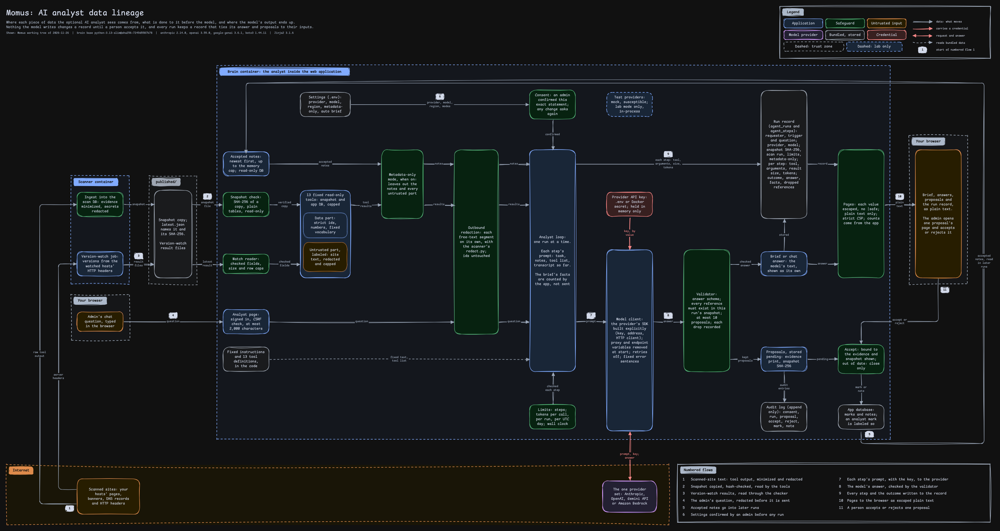

# Momus

Momus scans the internet-facing systems you own for known vulnerabilities and keeps track of what it finds from one scan to the next. It runs as two containers: a scanner built on Kali Linux that runs well-known open-source scan tools, and a web application (the "brain") where you set the scope, approve scans, and read results. An optional AI analyst in the brain summarizes results and proposes marks, and a person must accept each proposal.

## How it works

### Data flow and trust boundaries

What runs in each container, what crosses between them, and every outside service Momus contacts. [Details](docs/diagrams/README.md)

[](docs/diagrams/README.md)

### Scan authorization policy

Every check a host has to pass before Momus sends it anything, who sets each one, and what happens when a check fails. [Details](docs/diagrams/scan-policy.md)

[](docs/diagrams/scan-policy.md)

### AI analyst data lineage

What the optional AI analyst is given, what it can produce, and what a person has to approve before anything changes. [Details](docs/diagrams/ai-lineage.md)

[](docs/diagrams/ai-lineage.md)

## Ground rules

**The one rule: only the scanner sends scan probes to targets, and only the brain talks to a model provider.** The one exception is the optional seeder, which sends its own DNS traffic (API calls and zone transfers) to the DNS servers you configure, outside the scanner's exclusions and firewall ([data flows](docs/data-flows.md#sent-by-the-seeder-optional-off-unless-the-seed-profile-is-used)). The two containers share no network. They exchange files through two folders, each written by one side and read by the other.

**Use it only on systems you own.** Before the scanner sends anything to a domain, an administrator must state that they own it, and the scanner must find a DNS record that only your install can produce. If a later lookup of that record fails (rather than finds a wrong value), a domain verified in the last 7 days still counts ([DNS proof](docs/scope-and-authorization.md#2-dns-proof)). These checks help you avoid mistakes. They do not make scanning someone else's systems permitted. Read [responsible use](docs/responsible-use.md) before your first scan.

Momus is for a security engineer or a small team that wants a self-hosted scanner for its own domains, with a record of what was scanned, when, and on whose approval.

License: [MIT](LICENSE). Source: <https://github.com/mgrofsky/momus>.

## Quick start: the lab demo

The lab demo scans a deliberately weak web server that runs in its own container. Everything runs on internal Docker networks with no route off your machine. It needs Docker with Compose 2.24.4 or newer (tested with v5.7.0; an older Compose cannot parse the project's Compose files), about 5 GB of disk for the images, and the private range `10.89.47.0/24` free on your machine. It needs no model key and no cloud account. Only the image builds use the internet, to download the base images and packages.

Run these commands in the project folder. The first one builds the images, which takes several minutes.

```sh
# 1. Build and start the scanner and the demo target in lab mode
docker compose -f compose.yaml -f compose.lab.yaml up -d --build scanner demo-target

# 2. Record the ownership statement for the lab's domain
docker compose -f compose.yaml -f compose.lab.yaml run --rm jobctl attest owned.demo.test --by "Your Name"

# 3. Run an inventory: discovery, DNS, and web fingerprinting; no port scan, TLS scan, or templates
docker compose -f compose.yaml -f compose.lab.yaml run --rm jobctl submit inventory --id demo-inventory --lab-target target.demo.test --lab-target notice.demo.test --lab-cidr 10.89.47.0/24
docker compose -f compose.yaml -f compose.lab.yaml run --rm jobctl wait demo-inventory

# 4. Approve active checks for what that inventory found
docker compose -f compose.yaml -f compose.lab.yaml run --rm jobctl approve demo-inventory --by "Your Name"

# 5. Run a full scan (a few minutes)
docker compose -f compose.yaml -f compose.lab.yaml run --rm jobctl submit full --id demo-full --lab-target target.demo.test --lab-target notice.demo.test --lab-cidr 10.89.47.0/24 --approved-host target.demo.test
docker compose -f compose.yaml -f compose.lab.yaml run --rm jobctl wait demo-full

# 6. Read the results: job states, then the HTML report and CSV files
docker compose -f compose.yaml -f compose.lab.yaml run --rm jobctl status
docker compose -f compose.yaml -f compose.lab.yaml cp scanner:/srv/published/reports ./demo-reports
```

Each `wait` prints the job's final status. `"state": "done"` means it finished; `"findings_open"` counts what the full scan found. Open `demo-reports/demo-full/demo-full.html` in a browser. The status also lists the lab's domain as `pending`: its DNS record does not exist, so nothing is sent to it, and only the lab targets are scanned.

`jobctl` is a small developer tool that writes job files and reads results, as the brain does. In lab mode the brain has no published port, so the demo uses `jobctl` instead of the web pages. `tests/e2e/run_demo_ui.sh` drives the same lab through the brain's pages.

When you are done, remove the lab's containers, networks, and volumes:

```sh
docker compose -f compose.yaml -f compose.lab.yaml --profile dev down -v
```

## Using it on your own domains

Two things must be true first:

- **The Docker host must support iptables and ip6tables** in the scanner's network namespace, IPv4 and IPv6 alike. The scanner installs its egress firewall with both at every start, reads the rules back, and exits with an `entrypoint: FATAL:` line in `docker compose logs scanner` if either cannot be installed or verified. There is no switch to skip the firewall.
- **Each domain's authoritative nameservers must have public addresses.** The DNS proof asks them directly; if any nameserver of a domain resolves to a private or other non-public address, the domain is refused and never scanned ([scope and authorization](docs/scope-and-authorization.md#2-dns-proof)).

Start the scanner and the brain (without the lab file):

```sh
cp .env.example .env
docker compose up -d --build
docker compose logs brain
```

The log shows a one-time bootstrap token. Open `http://127.0.0.1:8080`, enter the token, and create the first account. The web pages are published on your machine's loopback address only. To reach them from elsewhere, put a reverse proxy with TLS in front ([operations](docs/operations.md#running-behind-a-reverse-proxy-with-tls)).

Then, in this order:

1. **Set the scope.** On the Scope page, add each domain, and add exclusions, owned address ranges, the check profile, and the rate profile as you need them ([scope and authorization](docs/scope-and-authorization.md)).
2. **State ownership.** Adding a domain requires ticking "I own this domain and the systems it points to." Your name and the time are recorded in the audit log and in every job.
3. **Publish the DNS record.** The scanner makes a token for each domain. The Scope page shows the exact TXT record to publish, at `_scan-verify.<domain>`. After publishing it, click "Check DNS proof now" and wait until the domain shows `verified`.
4. **Run an inventory.** On the Runs page, queue an inventory run. It finds and classifies your hosts. It is not passive: before you approve anything, it sends DNS questions to your domain's nameservers (including a zone-transfer attempt), and HTTP and HTTPS requests with a TLS handshake plus whatweb and wafw00f fingerprinting requests to every live host it finds. It runs no port scan, no TLS scan, and no nuclei templates. A name it discovers under your domain may point at a system you do not own, and these requests reach that system before you review the list; add exclusions on the Scope page first for names you know point elsewhere.
5. **Review and approve it.** On the Scope page, open the inventory, check every host and address it lists, and click "Approve after review". Active checks then run on the hosts that inventory listed, at the addresses it listed, with exceptions: a host you add to the approved hosts is port-scanned at whatever public addresses it resolves to, a host whose new address is in your owned ranges or a listed provider range is not held back, and a host the inventory classed as a CDN or third-party service by its CNAME keeps its approval while its CNAME stays with that provider (such hosts never get a port scan). Hosts that are new, or whose address changed otherwise, are held back until you approve a newer inventory ([hosts held back](docs/scope-and-authorization.md#8-hosts-and-domains-held-back)). The scanner checks the addresses it looked up itself; most tools are given host names and look them up again, so a record that changes in between can send them to another public address ([what the scope controls do not stop](docs/scope-and-authorization.md#what-these-controls-do-not-stop)).
6. **Run a full scan.** On the Runs page, queue a full run. The Schedules page can queue a daily recheck, a daily version watch, and a monthly full run.
7. **Read the results.** Overview, Findings, Assets, and Domains show the latest snapshot. Each finding has its evidence, score, and history. Mark a finding as a false positive, an accepted risk, or a duplicate when that is the case ([findings and evidence](docs/findings-and-evidence.md)).
8. **Optionally, configure the analyst.** Set a model provider in `.env`, recreate the brain, and confirm on the Settings page what will be sent to the provider ([the analyst](docs/analyst.md)). Everything else works without it.

## Documentation

- [Responsible use](docs/responsible-use.md): who may use this, on what, and what a scan does to a target.
- [Architecture](docs/architecture.md): the containers, the two folders, the two databases, and the life of a job.
- [Scope and authorization](docs/scope-and-authorization.md): every control between your intent and the first packet.
- [Threat model](docs/threat-model.md): each attacker, what the design stops, and what each can still do.
- [Data flows](docs/data-flows.md): everything that leaves the machine, to whom, and how to turn it off.
- [Findings and evidence](docs/findings-and-evidence.md): what is stored, redaction and its limits, retention, scores, and marks.
- [The analyst](docs/analyst.md): what the AI analyst can and cannot do, and how to configure a provider.
- [Version watch](docs/version-watch.md): tracking product versions against the fixed releases you name.
- [Configuration](docs/configuration.md): every setting of every container.
- [Operations](docs/operations.md): first start, backups, upgrades, a reverse proxy, and troubleshooting.
- [Updating the base image](docs/base-image.md).
- Reference: [job file format](docs/reference/job-format.md), [published folder](docs/reference/published-layout.md), [version-watch output](docs/reference/version-watch-schema.md), [HTTP API](docs/reference/http-api.md).
- Cloud examples: [AWS](deploy/aws/README.md) and [Google Cloud](deploy/gcp/README.md).
- [Third-party tools and licenses](THIRD-PARTY-TOOLS.md), [security policy](SECURITY.md), [contributing](CONTRIBUTING.md), [code of conduct](CODE_OF_CONDUCT.md), and [changelog](CHANGELOG.md).

## Limits you should know

- **A clean result is not proof of safety.** The scanner finds what its tools and templates know about. A finding is marked fixed only when a later scan looked for it and did not find it, but a server that answers promptly with an error or block page can still make a finding look fixed.
- **Redaction is best effort.** The scanner stores a minimal, redacted record of each finding, but pattern matching misses secrets without a recognizable shape. Raw tool output stays unredacted on the scanner's disk until a retention job removes it, and nothing removes it automatically. If you turn on the analyst, text from scanned sites (after redaction) and the IP addresses of your hosts go to the model provider you choose.
