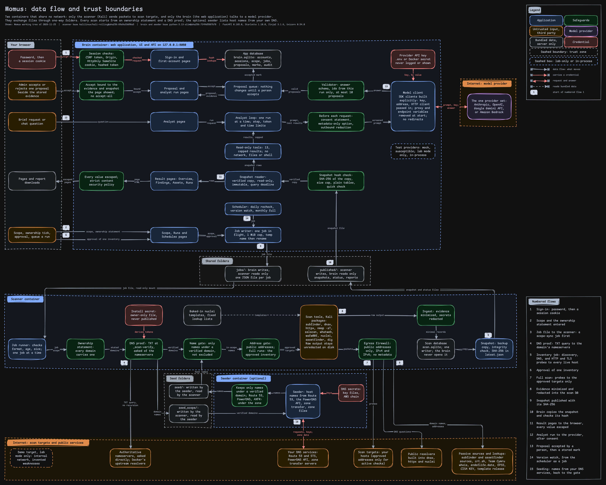

# Data flow diagram

`momus-dataflow.excalidraw` is the source. It is drawn in Excalidraw's hand-drawn style: the code font (Comic Shanns) for all text and sloppiness 2 on every element. `momus-dataflow.svg` and `momus-dataflow.png` are the dark-theme export, the primary one; `momus-dataflow-light.svg` and `momus-dataflow-light.png` are the light-theme export of the same scene. Both PNGs are 3200 pixels wide, and both SVGs embed the font they use. No export embeds the scene.

Two more diagrams are in this folder: the [scan authorization policy](scan-policy.md), which shows what decides whether Momus sends anything to a host, and the [AI analyst data lineage](ai-lineage.md), which shows what the model sees, what it produces, and the record kept.

## Reading the diagram

The top half is the brain, the web application. Its columns run left to right in the order data moves: your browser, the edge checks (session checks, output escaping, and the accept check), the pages and API, the services (the app database, the proposal queue, the analyst loop and its read-only tools, the snapshot reader, the scheduler, and the job writer), the safeguards that screen the model's traffic, the model client, and the model provider. Every box sits on the row of the traffic it handles, so each safeguard lines up with what it screens.

The two shared folders sit between the brain and the scanner. The scanner runs left to right below them: the job runner, the scope controls (ownership statement, DNS proof, name gate, address gate), the scan tools, the egress firewall, then ingest, the scan database, and the published snapshot. The optional seeder and its two folders sit under the scanner. Third-party services run along the bottom band. The legend is at top right and the numbered flows at lower right.

What it shows at a glance:

- No arrow goes from the scanner to a model provider, and none from the brain to a scan target.
- No network arrow joins the scanner and the brain. Only the `jobs/` and `published/` folders do, each in one direction.
- Credentials travel only on red arrows: the sign-in and session, the provider API key (into the model client and on to its provider), and the seeder's DNS secrets (to your DNS services). The scanner's install secret only derives DNS proof tokens inside the scanner and has no arrow out of it.

### Colors and lines

| Mark | Meaning |
|---|---|
| Blue box | Application code: the brain, the scanner's own code, the seeder |
| Green box | Safeguards: a check that screens the flow on its row |
| Amber box | Untrusted input (what you type, what a scanned site returns), or a third-party program or service |
| Purple box | A model provider |
| Gray box | Bundled or server-only data: databases, folders, baked-in templates |
| Red box or arrow | A credential, or a flow that carries one |
| Double-headed red arrow | A request with a credential, and its answer |
| Dashed gray arrow | A read of bundled data |
| Dashed box | A lab-only or in-process stand-in: the demo target and the test providers `mock` and `susceptible` |
| Dashed rectangle with a tab | A trust zone |
| Small dark tab with a number | The start of a numbered flow |

In the dark export Excalidraw's own dark theme shifts every color, so the same roles read as lighter strokes on dark fills.

## Trust boundaries and what crosses each

- **Your browser.** Everything typed here is untrusted. Into the brain: the password and session cookie (flow 1), scope and the ownership statement (2), the approval of one inventory (6), the analyst question (12), and the accept or reject of a proposal (13). Out of the brain: escaped pages and report downloads (11).
- **Brain container.** The web application on `127.0.0.1:8080`, with the app database, the analyst, and the model client. Its own network, `brain_net`, has no route to the scanner. It sends only to the one model provider you set (a red double arrow with the key), and only after an admin confirms the statement of what is sent. It never sends to a scan target.
- **Internet: model provider.** Anthropic, OpenAI, Google's Gemini API, or Amazon Bedrock: the one you set. Only the brain's model client reaches it.
- **Shared folders.** `jobs/`: the brain writes, the scanner reads (read-only there): job files (3, 14). `published/`: the scanner writes, the brain reads (read-only there): snapshots, status, reports, scope status, and the heartbeat (9, 10).
- **Scanner container.** Kali-based; the only container that sends packets to scan targets. Into it: job files from `jobs/`, and host names from `seed/`, which pass the name gate like every other name. Out of it: the DNS proof's TXT queries to each domain's nameservers (4), the inventory's discovery, lookups, and HTTP and TLS probes (5), probes to approved targets (7), and DNS questions to public resolvers, all through the egress firewall; the snapshot and status files to `published/` (9); and the names of the DNS-verified domains to `seed_scope/`. The install secret never leaves it.
- **Seed folders.** `seed/`: the seeder writes, the scanner reads (read-only there): host names only. `seed_scope/`: the scanner writes, the seeder reads (read-only there): the DNS-verified domain names only. The brain mounts neither, and the seeder mounts nothing else of the scanner's.
- **Seeder container (optional).** Runs only with the Compose profile `seed`. It sends requests with its own credentials to the DNS services you configure (15), keeps only names under a DNS-verified domain (and, for Route 53, zone transfers, and PowerDNS, only names under the zone it asked for), and writes them to `seed/`. Its network has no route to the scanner or the brain.
- **Internet: scan targets and public services.** Your hosts: the inventory's HTTP and TLS probes reach every live host it finds, before any approval, and active checks reach approved addresses only; the domains' authoritative nameservers and Docker's upstream resolvers; the public resolvers built into dnsx, httpx, and nuclei; the passive sources and lookups (subfinder and assetfinder sources, crt.sh, Team Cymru whois, endoflife.date, EPSS, CISA KEV, and the nuclei template release); your DNS services, reached only by the seeder; and the lab-only demo target.

## Numbered flows

Numbered in the order a first scan happens.

1. **Sign-in.** A password, then a session cookie, checked for a CSRF token and an allowed Origin; the cookie is `HttpOnly` and `SameSite=Strict`, and only hashes are stored.
2. **Scope and ownership.** An admin adds domains and ticks the ownership statement on the Scope page; it is stored in the app database.
3. **Job file.** The job writer writes one job at a time to `jobs/` (temporary name, then rename, 1 MiB at most). The first is a scope-sync job; inventory, full, recheck, and version-watch jobs travel the same way. The job runner checks format, age, and size, and refuses any job that carries a DNS proof token.
4. **DNS proof.** The scanner derives each domain's token from its install secret and asks the domain's nameservers directly for the TXT record at `_scan-verify.<domain>`, with no recursion.
5. **Inventory.** Discovery for each DNS-verified domain: passive sources, certificate logs, and DNS (including a zone-transfer attempt to the domain's nameservers), then HTTP and TLS probes (HTTP and HTTPS requests with a TLS handshake, and whatweb and wafw00f fingerprinting) to every live host it finds that passes the gates, all through the egress firewall and before any approval. Its tab sits on the arrow to the passive sources; the probes travel on the "probes" arrow to the scan targets, as a full scan's do. No port scan, TLS scan, or templates.
6. **Approval.** An admin approves one inventory after review. Full runs and rechecks then check only the hosts and addresses it listed.
7. **Full scan.** Probes go only to names that pass the name gate and addresses that pass the address gate, through the egress firewall, which allows public addresses only, apart from the container's own loopback interface (traffic there never leaves the container) and narrow DNS, IPv6 neighbor-discovery, and lab-mode allowances ([threat model](../threat-model.md)).
8. **Evidence.** Ingest keeps a minimal, redacted record of each finding in the scan database. The raw tool output stays unredacted in the scanner's data volume until a retention job removes it.
9. **Snapshot.** The scanner copies the scan database, checks the copy's integrity, and publishes it with its SHA-256 in `latest.json`.
10. **Brain reads the snapshot.** The brain copies the file named in `latest.json`, refuses it unless the copy's SHA-256 matches, its size is under the cap, it holds plain tables only, and it passes a quick check, then opens it read-only and immutable.
11. **Pages.** Result pages read the snapshot and go to the browser with every value escaped, under a strict content security policy.
12. **Analyst run.** A brief or a chat question starts one run. Before each request the brain checks the admin's confirmed statement, applies the metadata-only setting, and redacts outbound text. The model client, built with explicit arguments and no proxy or endpoint from the environment, sends it to the one provider with the key.
13. **Proposal accepted.** The model's answer passes the validator (the answer schema, only ids returned in this run, at most 10 proposals). A proposal changes nothing until a person accepts it on its own page; the accept is bound to the evidence and snapshot the page showed, and only then is the mark stored.
14. **Version watch.** The scheduler queues a daily version watch (also a daily recheck and a monthly full run) as an ordinary job through the job writer.
15. **Seeding.** The optional seeder lists host names from Route 53, the PowerDNS API, zone transfers, and zone files, keeps only names under a DNS-verified domain (and, for Route 53, zone transfers, and PowerDNS, only names under the zone it asked for), and writes them to `seed/`. The scanner reads them as untrusted input and passes each through its name gate.

## Not drawn

- `jobctl`, the developer tool that also writes job files (profile `dev`, no network).
- The brain's reads of the other files in `published/` (job status, scope status, held-back hosts, version-watch results, reports, the heartbeat). Only the snapshot is drawn, since only it is copied and hash-checked; the `published/` box names the rest.
- The optional egress proxy `MOMUS_ANALYST_PROXY`, and the AWS credential endpoints Bedrock's default credential chain may contact when no key is set.
- Tool update checks: the scan calls pass `-duc`, but the calls that only read a tool's version do not, so they may contact ProjectDiscovery's update service.
- The EPSS and CISA KEV downloads at ingest and the Team Cymru and endoflife.date lookups are drawn as one arrow from the firewall to the passive sources and lookups box, not as separate flows from ingest.
- The DNS proof's queries leave through the egress firewall like everything else the scanner sends; the arrow is drawn straight from the DNS proof box to keep its row.
- The host recovery commands, the reverse proxy for TLS, the lab networks, and the retention and update-templates jobs.

## Editing and re-exporting

1. Open [excalidraw.com](https://excalidraw.com) and load `momus-dataflow.excalidraw` (menu, Open). Labels are bound to their boxes and arrows to their ends, so a box can be dragged and its arrows follow. Each zone is a group; double-click into a group to move one box.
2. Arrows with corners are Excalidraw elbow arrows; those with two corners have their middle segment pinned, so the app keeps their lane when a box moves. Straight arrows are plain arrows. Excalidraw puts an arrow's label at its middle, so a label sits on the middle segment of an elbow arrow, or on the corner of one with a single corner.
3. Keep the conventions: the code font, sloppiness 2, the three text sizes (40 for the title, 18 for boxes and the flows list, 14 for arrow labels and notes), stroke width 2 (1 for the small number tabs), and the colors in the table above. Boxes in a column share one width. Labels and tabs are sized for the code font with room to spare. Keep at least 40 pixels of line outside every arrow label in the 3200-pixel PNG, with the arrowhead visible, so each arrow's direction can be read; widen the gap between columns or rows rather than shorten the line.
4. Save the scene back to this file (menu, Save to, Disk). Keep the file's `"source"` value as `https://excalidraw.com`. Then export PNG and SVG twice, in dark and light theme (menu, Export image; turn off "Embed scene"; PNG at a scale that gives 3200 pixels wide), and replace the four image files.
5. When a flow changes, change the numbered-flows panel, its tabs, and the list above together.

To export without the web app, use the `@excalidraw/excalidraw` package in a headless browser: load the scene with `loadFromBlob`, then call `exportToSvg` (fonts inlined) for the SVGs and `exportToBlob`, scaled to 3200 pixels wide, for the PNGs, once with `exportWithDarkMode` on and once off. None of this tooling is part of the project or its dependencies.
