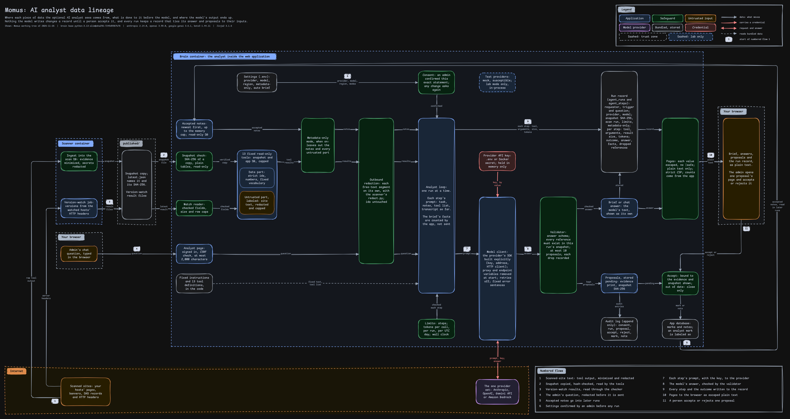

# AI analyst data lineage

`momus-ai-lineage.excalidraw` is the source, drawn in the same hand-drawn style as the [data flow diagram](README.md): the code font (Comic Shanns) for all text and sloppiness 2 on every element. `momus-ai-lineage.svg` and `momus-ai-lineage.png` are the dark-theme export, the primary one; `momus-ai-lineage-light.svg` and `momus-ai-lineage-light.png` are the light-theme export of the same scene. Both PNGs are 3200 pixels wide, both SVGs embed the font they use, and no export embeds the scene.

The diagram covers only the optional AI analyst ([analyst.md](../analyst.md)). It answers six questions: where each piece of data the model sees comes from, what is done to it on the way, which model gets it, what the model produces, what checks that output passes, and where the output ends up. It also shows what record lets a person trace an answer or a mark back to its inputs.

## Reading the diagram

The diagram reads left to right, from where data starts to where it ends up:

1. **Origins.** Text from scanned sites (in the Internet band at the bottom), which reaches the scanner as raw tool output and as the HTTP headers that version-watch jobs read. Next come the admin's chat question, typed in the browser; the settings that pick the provider and model; the provider API key; and the fixed instructions and tool definitions bundled in the brain's code. Notes a person accepted in earlier runs come back in through the loop drawn over the top.
2. **Changes made before the model.** Each change sits on the row of the data it changes:
   - Ingest minimizes the evidence and redacts secrets before anything reaches the scan database.
   - The scanner publishes a snapshot copy, and `latest.json` names its SHA-256.
   - The brain copies that file, checks its hash and schema, and opens it read-only. Version-watch results go through the brain's own bounded reader.
   - The 13 fixed, read-only tools return two parts. The data part holds strict identifiers, numbers, and words from fixed lists. The untrusted part, labeled as such, holds the redacted and capped text that came from scanned sites.
   - Accepted notes are read newest first, up to `MOMUS_ANALYST_MEMORY_CHARS` characters.
   - Metadata-only mode, when on, leaves out the notes and every untrusted part.
   - Outbound redaction runs on each free-text segment on its own: the question, each note, each untrusted part, and each corrective note.
   - The consent statement must be confirmed before any run, and the limits are checked at every step.
3. **The model.** The analyst loop builds each step's prompt and sends it through the model client to the one provider set in `MOMUS_ANALYST_PROVIDER`. The key travels on red arrows only: from where it is stored into the client, then on to the provider with each request. The test providers `mock` and `susceptible` are in-process stand-ins that work only in lab mode (`MOMUS_LAB=1`).
4. **Outputs and their checks.** The validator checks the answer against its schema. It drops any item that names a finding, host, or run missing from the run's own snapshot, keeps at most `MOMUS_ANALYST_MAX_PROPOSALS` proposals, and records each drop. What remains is a brief or chat answer, plus proposals stored as pending.
5. **Human decision and resting place.** A person accepts or rejects each proposal on its own page. An accept is bound to the evidence fingerprint and snapshot SHA-256 that page showed. A mark or note lands in the app database. Accepted notes feed later runs (flow 5). Everything reaches the browser as escaped plain text.
6. **The record.** The run record and the audit log, described [below](#what-each-run-keeps).

What it shows at a glance:

- Nothing the model writes changes a mark, note, score, or setting by itself. The only path from the model's answer to a stored mark or note passes through the validator, the pending proposal, a person's accept, and the accept check.
- Scanned-site text reaches the model only after two redaction passes (ingest at the scanner, then the field pass inside the tools), plus the outbound pass. It always arrives labeled as untrusted, and it does not arrive at all in metadata-only mode.
- The scanner has no arrow to the model provider.

### Colors and lines

| Mark | Meaning |
|---|---|
| Blue box | Application code: the brain's readers, tools, loop, model client, pages, and the scanner's version-watch job |
| Green box | Safeguard: a check or change that screens the flow on its row |
| Amber box | Untrusted input: scanned sites, what the admin types, and the browser that shows the results; also the untrusted part of a tool result |
| Purple box | The model provider |
| Gray box | Bundled or stored data: settings, fixed instructions, the shared folder, the run record, the audit log, the app database |
| Red box or arrow | A credential, or a flow that carries one |
| Double-headed red arrow | A request with a credential, and its answer |
| Dashed gray arrow | A read of bundled data |
| Dashed box | The in-process test providers, lab mode only |
| Dashed rectangle with a tab | A trust zone |
| Small dark tab with a number | The start of a numbered flow |

In the dark export, Excalidraw's dark theme shifts every color, so the same roles show as lighter strokes on dark fills.

## Trust boundaries and what crosses each

- **Internet.** The scanned sites: whoever controls a site controls its page text, banners, DNS values, and headers. That text enters only through the scanner (flows 1 and 3). The model provider is the one service the brain sends analyst requests to (flow 7). The request carries the prompt and the key; the answer comes back on the same red arrow.
- **Scanner container.** Ingest turns raw tool output into minimized, redacted records in the scan database. The version-watch job writes its results. Out of the scanner go only files in `published/`. The scanner never receives the brain's `.env`, and so never receives the analyst's key. It is on its own network (`scanner_egress`).
- **published/.** The scanner writes and the brain reads, read-only: the snapshot with `latest.json` (flow 2), and the version-watch result files (flow 3).
- **Your browser (asks).** The admin's chat question enters through the analyst page: signed in, with the anti-forgery check, and limited to 2,000 characters (flow 4).
- **Brain container.** Everything between the shared folder and the browser: the readers, the tools, the outbound safeguards, the loop, the model client, the validator, the run record, the accept check, and the app database. Settings come from `.env`. The key comes from `MOMUS_ANALYST_API_KEY` or from the file named in `MOMUS_ANALYST_API_KEY_FILE`.
- **Your browser (reads and decides).** Out of the brain: the brief, chat answers, proposals, and the run record, all as escaped plain text under a strict content security policy (flow 10). Into the brain: one accept or reject per proposal (flow 11).

## Numbered flows

1. **Scanned-site text.** The scan tools' raw output goes to ingest, which minimizes evidence and redacts secrets into the scan database (`scanner/pipeline/ingest.py`, `scanner/pipeline/minimize.py`, `scanner/pipeline/redact.py`).
2. **The snapshot.** It is published with its SHA-256, copied by the brain while hashing, accepted only when the hash, schema, and quick check pass, and opened read-only (`brain/app/snapshot.py`). The run pins it at its start. Every tool reads that copy.
3. **Version-watch results.** They are read through the brain's bounded reader (`brain/app/published.py`). The only text in them that came from a target, each host's `server` header, goes to the untrusted part.
4. **The chat question.** The analyst page passes it on, it is redacted on its own, and it is placed in the task as a JSON string.
5. **Accepted notes.** Notes a person accepted are read in later runs: in each prompt (newest first, up to `MOMUS_ANALYST_MEMORY_CHARS`), and through the `accepted_notes` tool. Metadata-only mode leaves them out.
6. **Consent.** The settings named in `MOMUS_ANALYST_PROVIDER`, `MOMUS_ANALYST_MODEL`, `MOMUS_ANALYST_REGION`, `MOMUS_ANALYST_METADATA_ONLY`, and `MOMUS_ANALYST_AUTO_BRIEF` (and the proxy, when set) make up the statement of what is sent and to whom. An admin confirms it on the Settings page. Its SHA-256 is stored, and any change asks again. No run starts without it (`brain/app/analyst/consent.py`).
7. **Each step's prompt.** The loop sends the fixed instructions, the task, the notes, the tool list, and the transcript so far to the model client, which sends it with the key to the provider. The limits are checked before each step: steps, output tokens per call, tokens per run, tokens per UTC day, and wall-clock time. Only one run goes at a time (`brain/app/analyst/runner.py`).
8. **The answer.** The validator checks it (`brain/app/analyst/proposals.py`). Kept items become the brief or chat answer and the pending proposals. Each proposal is stored with the finding's evidence fingerprint, the finding's last run, and the snapshot SHA-256.
9. **The run record.** It is written at the start, after every step, and at the end.
10. **Pages.** The brief, answers, proposals, and record reach the browser as escaped plain text. The counts on a brief come from the application's own query of the snapshot, never from the model.
11. **The decision.** A person accepts or rejects one proposal. An accept is refused if the evidence fingerprint or snapshot SHA-256 differs from what the page showed. An out-of-date proposal can only be closed. An accepted mark goes through the same code as a manual mark, and an accepted note goes into `notes`.

## What each run keeps

All of this is in the app database, written by the code named:

- **`agent_runs`**, one row per run (`brain/app/analyst/runner.py`): when it started and finished, the trigger and who asked, the chat question, the provider and model name, the scan run id, and the snapshot's SHA-256. It also keeps whether metadata-only mode was on, the limits in force, the step count, tokens in and out, the tools called in order, and the outcome or fixed error. Then come the validated answer, the facts the application computed for a brief, what the validator dropped and why (fixed reasons, never the model's text), the count of invalid answers, and whether any untrusted text read like instructions to an AI (a hint).
- **`agent_steps`**, one row per step: its kind (tool, final, invalid, error), the tool name, the arguments as the model wrote them (capped), the size of the tool result, tokens in and out, and a fixed error sentence.
- **`proposals`**: the run, kind, finding, the model's reason, references, evidence fingerprint, the finding's last run, snapshot SHA-256, the instruction warning, status, and who decided and when. A closed proposal also gets the fixed reason it was closed.
- **`finding_marks`** and **`notes`**: an accepted mark records the proposal it came from, and an accepted note records its run and proposal.
- **`audit_log`**, append-only: `analyst-consent`, `analyst-run`, `analyst-proposal`, `proposal-accept`, `proposal-reject`, `mark-add`, and `note-add`, each with the actor, time, target, and address.
- **`agent_messages`**: the full prompts and responses, but only when `MOMUS_ANALYST_DEBUG=1`, and never in lab mode. Otherwise nothing is written there.

## What never enters the lineage

- **Raw scan tool output.** It stays on the scanner's disk. Only ingest's minimized, redacted records reach the scan database, the snapshot, and so the tools.
- **The tool results as sent.** The record keeps each call's tool, arguments, and result size, not the result. Prompts and responses are kept only in debug mode, as above.
- **The provider key in any stored place.** It is held in memory only. It is never written to the app database, the run record, the audit log, a log line, or an error message: provider errors are fixed sentences. The consent statement names the provider, not the key.
- **Any path from the scanner to the provider.** The scanner does not get the key and has no arrow to the model. The provider is reached only by the brain's model client.
- **The model's text as markup or as a record change.** It is never rendered as HTML, and it never becomes a mark or note without a person's accept.

## Not drawn

- The API routes under `/api/v1/analyst`, which give the same data and decisions as the pages, under the same checks.
- How a run is started: on request, or for each new snapshot when `MOMUS_ANALYST_AUTO_BRIEF=1`. Also not drawn: the run-start checks (provider usable, consent current, redaction module loaded, a verified snapshot, budget left) and the cleanup of interrupted or abandoned runs.
- The optional egress proxy `MOMUS_ANALYST_PROXY`, and the AWS credential endpoints Bedrock's default credential chain may contact when no key is set.
- The provider check tool `brain/tools/smoke_provider.py`.
- The `existing_marks` tool's reads of manual marks. A mark accepted from a proposal is not returned to later runs.

## Editing and re-exporting

Follow [Editing and re-exporting](README.md#editing-and-re-exporting) in the data flow diagram's page, with this diagram's file names. When a flow changes, change the numbered-flows panel, its tabs, and the list above together.
