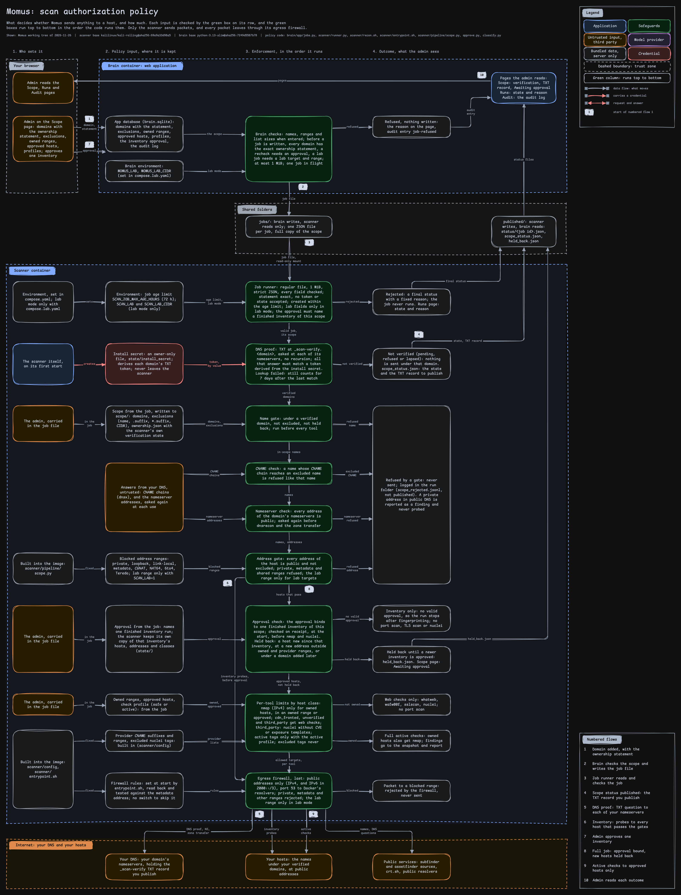

# Scan authorization policy diagram

`momus-scan-policy.excalidraw` is the source. It is drawn in Excalidraw's hand-drawn style: the code font (Comic Shanns) for all text and sloppiness 2 on every element. `momus-scan-policy.svg` and `momus-scan-policy.png` are the dark-theme export, the primary one; `momus-scan-policy-light.svg` and `momus-scan-policy-light.png` are the light-theme export of the same scene. Both PNGs are 3200 pixels wide, and both SVGs embed the font they use. No export embeds the scene.

The diagram answers one question: what decides whether Momus sends anything to a host, and how much. [Scope and authorization](../scope-and-authorization.md) describes each control in words, with the tests that show it.

## Reading the diagram

The columns run left to right in the order a decision moves:

1. **Who sets it.** The admin on the Scope page (carried to the scanner in the job file), the environment set in `compose.yaml` and `compose.lab.yaml`, the scanner itself on its first start, or the scanner image.
2. **Policy input, where it is kept.** The brain's app database, the scope the job runner writes from each job, the install secret, the answers your DNS gives, and the lists built into the image.
3. **Enforcement, in the order it runs.** Green boxes, top to bottom in the order the code runs them, each on the row of the input it checks: the brain's checks before a job is written, the job runner, the DNS proof, the name gate, the CNAME check, the nameserver check, the address gate, the approval check and the held-back decision, the per-tool limits, and the egress firewall last.
4. **Outcome, what the admin sees.** Rejected, not verified, refused by a gate, inventory only, held back, web checks only, full active checks, and a packet the firewall stops. Each says where the result is written and which page shows it.

The brain is on top, the two shared folders under it, and the scanner below them. Your DNS, your hosts, and the public services the inventory asks run along the bottom band. The legend is at top right and the numbered flows at lower right.

What it shows at a glance:

- The brain never sends anything to a host. Its checks only decide whether a job file is written to `jobs/`.
- The scanner checks every job again on its own, and every packet it sends leaves through the egress firewall, the last green box.
- The inventory is not passive. Before any approval, names under a verified domain that pass the name gate are resolved, and hosts that also pass the CNAME check and the address gate get HTTP and HTTPS requests with a TLS handshake and the whatweb and wafw00f requests (flow 6). The approval check and the per-tool limits decide only the active tools: nmap, sslscan, and nuclei.
- The install secret is the only credential, and its red arrows stay inside the scanner. Only the TXT value derived from it is published.
- The arrow for the inventory's probes runs down a lane left of the green column and crosses the input arrows of the approval check and the per-tool limits. Those are the only crossings.

### Colors and lines

| Mark | Meaning |
|---|---|
| Blue box | Application code: the brain's pages, the scanner itself |
| Green box | Safeguards: a check on the input on its row |
| Amber box | Untrusted input (what the admin types, what your DNS answers), or a third-party service |
| Gray box | Server-only data: the app database, folders, environment settings, lists built into the image, and the outcome records |
| Red box or arrow | A credential, or a flow that carries one (the install secret) |
| Dashed rectangle with a tab | A trust zone |
| Small dark tab with a number | The start of a numbered flow |

The diagram has no model provider, so no purple box. The analyst's own policy (what it may send to a provider) is in [the analyst page](../analyst.md).

In the dark export Excalidraw's own dark theme shifts every color, so the same roles read as lighter strokes on dark fills.

## Trust boundaries and what crosses each

- **Your browser.** What the admin types is untrusted input: domains with the ownership statement, exclusions, owned ranges, approved hosts, profiles (flow 1), and the approval of one inventory (7). Back out come the Scope, Runs, and Audit pages (10).
- **Brain container.** It stores the scope in its app database and checks it before it writes a job (`build_job` in `brain/app/jobs.py`). A refused job is never written: the reason is shown on the page and an audit entry `job-refused` is written. It reads `MOMUS_LAB` and `MOMUS_LAB_CIDR` from its own environment. It never contacts a host.
- **Shared folders.** `jobs/` carries each job file from the brain to the scanner, which mounts it read-only (flows 2 and 3). `published/` carries the scanner's results back: the status of each job, `scope_status.json` (each domain's state and the TXT record to publish, flow 4), and `held_back.json`. The brain only reads it.
- **Scanner container.** It trusts nothing in a job it has not checked. The job runner validates the file and the scope, and binds any approval to an inventory before it writes the scope. The DNS proof, the gates, and the hold-back run inside the scan. The install secret is created here on first start, kept in an owner-only file, and never leaves.
- **Internet: your DNS and your hosts.** Every packet crosses here through the egress firewall: the DNS proof, nameserver, and zone-transfer questions to your nameservers (flow 5); the inventory's probes and the active checks to your hosts (flows 6 and 9); and domain names and DNS questions to public services (subfinder's and assetfinder's sources, crt.sh, public resolvers). Every answer from here is untrusted.

## Numbered flows

The flows follow one host from "added to scope" to "actively scanned".

1. **Domain added, with the ownership statement.** The admin adds the domain on the Scope page and ticks the statement. The brain stores it with who attested and when.
2. **Brain checks the scope and writes the job file.** Every domain must carry the exact statement. A recheck needs an approval, and a lab job needs a lab target and a lab range. The file is at most 1 MiB, and only one job is in flight at a time.
3. **Job runner reads and checks the job.** It must be a regular file of at most 1 MiB and strict JSON, and every field is checked. A job carrying a token or a verification state is rejected. So is a job older than `SCAN_JOB_MAX_AGE_HOURS` (72 hours by default), a job with lab fields outside lab mode, or an approval that does not bind to a finished inventory of this scope. A rejected job gets a final status with a fixed reason and never runs.
4. **Scope status published.** `scope_status.json` gives each domain's state and the exact TXT record to publish at `_scan-verify.<domain>`. The Scope page shows it, and you publish the record in your DNS.
5. **DNS proof.** At the start of every run, the scanner asks each of the domain's nameservers directly, with no recursion. Every nameserver that answers must return the token derived from the install secret. If the lookup fails, the domain still counts for 7 days after its last match. A domain that is pending, refused, or lapsed gets nothing.
6. **Inventory.** Before each tool, the names it is given pass the gates again. Before any approval, names that pass the name gate are resolved, and every host that also passes the CNAME check and the address gate gets the inventory's probes: HTTP and HTTPS with a TLS handshake, whatweb, and wafw00f. dnsrecon and the zone transfer run only against nameservers whose addresses pass again.
7. **Admin approves one inventory.** The approval names one finished inventory run and travels in later jobs.
8. **Full job: approval bound, new hosts held back.** The approval is checked when the job arrives, at the start of the run, and before nmap and nuclei. A host is held back until a newer inventory is approved if it is new since the approved inventory, or has a new address outside the owned and provider ranges, or sits under a domain added later. Held-back hosts are listed in `held_back.json` and under "Awaiting approval" on the Scope page.
9. **Active checks to approved hosts only.** nmap runs only on the IPv4 addresses of `owned` hosts: every address in an owned range, or the host in the approved-hosts list. `cdn_fronted`, `unverified`, and `third_party` hosts get web checks only. `third_party` hosts get nuclei without CVE or exposure templates. Active-tag templates run only with the `active` check profile, and the excluded tags never run.
10. **Admin reads each outcome.** The Runs page shows each job's state and reason, the Scope page shows verification and the held-back list, and the Audit page shows the audit log.

## Not drawn

- The scope-sync job. It writes the scope and runs only the DNS proof, so it sends DNS questions and nothing else.
- The version watch. It sends one `GET /` per listed host, after the same name, CNAME, and address checks.
- The retention and template-update jobs, which send nothing to your hosts.
- The command-line approval on the scanner host (`scanner/pipeline/approve.py`). It writes an approval into the current scope folder, and the next job's scope replaces that folder.
- Host names from the optional seeder. They are untrusted discovery input and pass the same name gate as any other name ([data flow diagram](README.md), flow 15).
- The rate profiles. They set how fast each tool sends, not what it may send to.
- Classification itself (which rule puts a host in `owned`, `cdn_fronted`, `third_party`, `unverified`, `internal`, or `dead`). It is folded into the per-tool limits box; [section 9 of Scope and authorization](../scope-and-authorization.md#9-host-classes-and-what-each-receives) has the table.
- The CNAME exception in the held-back decision: a CDN or provider host the inventory classed by its CNAME is not held back for a new edge address while it keeps a CNAME under the same suffix.
- A recheck without a valid approval fails at its start instead of running as an inventory.

## Editing and re-exporting

Follow [Editing and re-exporting](README.md#editing-and-re-exporting) in the data flow diagram's page, with this diagram's files.
